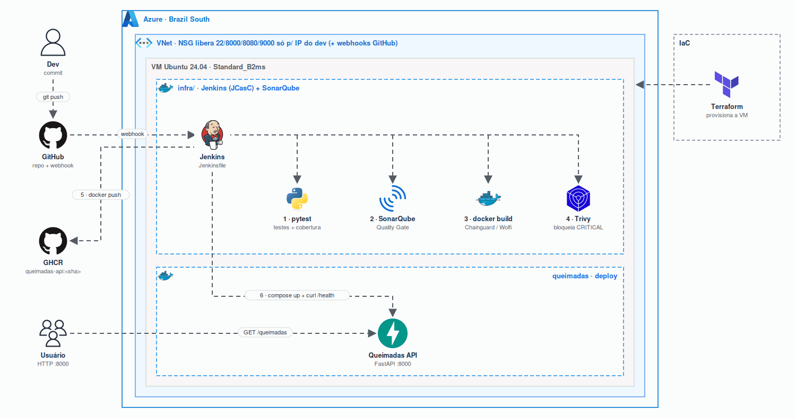

<h1 align="center">Queimadas API · GS 2026 DevSecOps (CitizenTech)</h1>

<p align="center"></p>

<p align="center">
  
  
  
  
  
  
  
  
  
</p>

API com focos de queimadas por bioma e mês (INPE, 2024-2025), usada como aplicação de uma pipeline DevSecOps de CI/CD: testes, qualidade, segurança, imagem Docker e deploy automatizado.

**Participante:** Luiz Brito

## Endpoints

| Método | Rota | Descrição |
|---|---|---|
| GET | `/health` | status da aplicação |
| GET | `/queimadas?bioma=Pantanal` | focos por bioma e mês (filtro opcional) |

## Pipeline (`Jenkinsfile`)

Disparada automaticamente por **webhook do GitHub** a cada push na `main`. As ferramentas rodam como containers pelo Docker da VM.

| # | Etapa | O que faz | Bloqueia? |
|---|---|---|---|
| 1 | Testes | `pytest` com cobertura (`coverage.xml`) e JUnit | falha de teste |
| 2 | SonarQube | análise estática via `sonar-scanner-cli` | – |
| 3 | Quality Gate | `waitForQualityGate` (webhook do Sonar → Jenkins) | gate reprovado |
| 4 | Docker Build | imagem multi-stage Chainguard (Wolfi), tag = SHA do commit | – |
| 5 | Trivy | relatório HIGH/CRITICAL (`trivy-report.txt`) | qualquer CRITICAL |
| 6 | Push | publica `ghcr.io/luizbrito7/queimadas-api:<sha>` e `:latest` | – |
| 7 | Deploy | `docker compose up` com a imagem nova | – |
| 8 | Validação | `curl` em `/health` e `/queimadas` | resposta ≠ 2xx |

## Infraestrutura

| Camada | Arquivos | O que faz |
|---|---|---|
| VM | [`terraform/`](terraform) | Azure (Brazil South): VNet, NSG (22/8000/8080/9000 só para o IP do dev, 8080 também para webhooks do GitHub), VM Ubuntu 24.04 `Standard_B2ms`; cloud-init instala Docker e o sysctl do SonarQube |
| CI/CD | [`infra/`](infra) | Docker Compose com Jenkins e SonarQube |
| Jenkins | [`infra/jenkins.yaml`](infra/jenkins.yaml) | Configuration as Code: admin, credenciais, servidor Sonar e o job (Job DSL) com trigger por push, sem wizard |
| SonarQube | [`infra/setup.sh`](infra/setup.sh) | via Web API (idempotente): troca senha do admin, gera token de análise, cria o webhook do Quality Gate |

Segredos ficam só no `infra/.env` da VM (fora do Git); modelo em [`infra/.env.example`](infra/.env.example).

### Subir do zero

```bash
# 1. VM
cd terraform && terraform init && terraform apply

# 2. Jenkins + SonarQube já configurados (na VM)
scp -r infra azureuser@<IP>:~ && ssh azureuser@<IP>
cd infra && cp .env.example .env   # preencher
./setup.sh

# 3. Webhook do GitHub -> http://<IP>:8080/github-webhook/
```

## Troubleshooting (etapa 6): falha controlada no Trivy

| Build | Commit | Resultado |
|---|---|---|
| #6 | `65f05db`: adiciona `Django==3.2.13` | ❌ Trivy: `Total: 3 (CRITICAL: 3)`, incl. CVE-2022-34265 (SQL injection), pipeline bloqueada antes do push |
| #7 | `18d3f82`: remove a dependência vulnerável | ✅ todas as etapas, 0 vulnerabilidades |

Outras falhas reais encontradas e corrigidas durante a montagem:

- **`ModuleNotFoundError: app`** nos testes: `pytest` chamado direto não coloca o diretório no path; trocado por `python -m pytest`.
- **Quality Gate sem task id**: a imagem do scanner grava o `report-task.txt` fora do workspace; resolvido com `sonar.working.directory` no workspace.
- **Webhook do Sonar recusado**: o SonarQube bloqueia URLs de IP privado (rede Docker); `sonar.validateWebhooks=false` aplicado pelo `setup.sh`.

## Rodar local

```bash
docker compose up -d --build
curl localhost:8000/health
```

## Testes

```bash
python3 -m venv .venv && .venv/bin/pip install -r requirements-dev.txt
.venv/bin/python -m pytest -q
```
